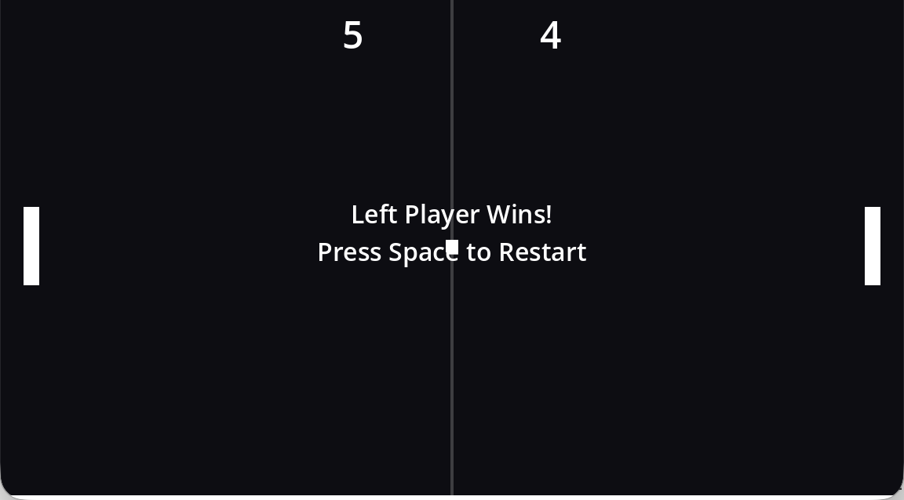

# Pong

A classic Pong game built in Godot 4.7, using GDScript only.



## Gameplay

- Left paddle vs. right paddle, ball bounces between them.
- Ball bounces off the top/bottom walls and paddles, speeding up slightly on each paddle hit (capped so it stays playable).
- Missing the ball scores a point for the other side.
- First to 5 points wins; the game shows the winner and can be restarted.

## Controls

| Player | Up | Down |
|---|---|---|
| Left paddle | `W` | `S` |
| Right paddle | `↑` | `↓` |

Press `Space` to restart after a game ends.

## Project structure

```
pong/
├── project.godot   # engine config, window size, input map
├── game.tscn        # scene tree: paddles, ball, walls, UI
├── game.gd          # scoring, win condition, restart logic
├── paddle.gd        # paddle input/movement/bounds
├── ball.gd          # ball movement, bouncing, scoring
└── game.skill.md    # original design spec for this project
```

## Running it

Open the project folder in Godot 4.7+ and press **Play** — `game.tscn` is configured as the main scene.
